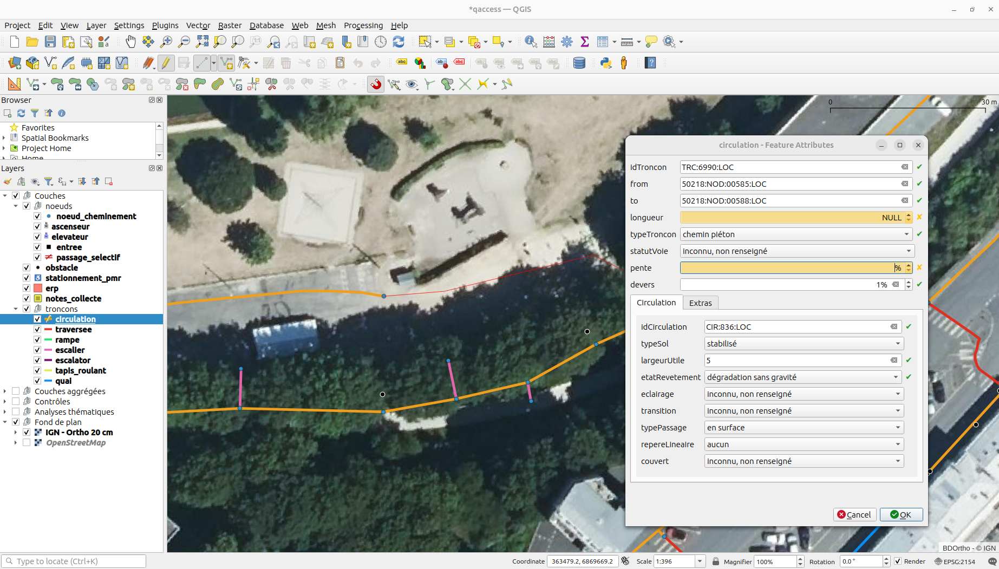

# Import de données de CNIG Accessibilité

!!! question "CNIG ? "

    Le Conseil national de l'information géographique (CNIG) est une instance consultative
    qui coordonne et accompagne l'évolution de l'information géolocalisée en France.
    Son groupe de travail sur l'accessibilité a élaboré un
    [standard de collecte](https://cnig.gouv.fr/ressources-accessibilite-a25335.html)
    pour définir les objets et les attributs que les collectivités territoriales
    doivent collecter.

    Un [gabarit au format Geopackage](https://github.com/cnigfr/schema-accessibilite-voirie/blob/main/Schema/format_cnig_accessibilite_geopackage/readme.md)
    a été défini pour faciliter les échanges de données entre logiciels.

Il est possible d'initialiser le graphe piéton d'Accèslibre Mobilités à partir d'un Geopackage
conforme au gabarit défini par le standard.

Ceci permet de poursuivre un chantier de collecte démarré dans un autre outil, ou d'utiliser
Accèslibre Mobilités pour réaliser la conversion en NeTEx d'une collect eexistante.

## Prévisualiser les données disponibles

Le fichier Geopackage peut être visualisé dans tout logiciel de bureau SIG gérant ce format
(QGIS, ArcGIS...).

Afin de vérifier la qualité des données, il est possible sur QGIS d'utiliser le projet
[QAcces](https://gitlab.com/someware/qaccess/qaccess).

<figure markdown>
  
  <figcaption>QAccess permet de visualiser le graphe et de le contrôler avant import.
</figure>

## Détails des données importées

L'intégralité des classes d'objet définies par le Standard CNIG Accessibilité sont importées
dans le [modèle de données d'Accèslibre Mobilités](/datamodel).

Pour connaître l'intégralité des règles de conversions appliquées lors de l'import,
se référer à la
[documentation du module d'import](https://gitlab.com/yukaimaps/cnig2wdm/-/blob/main/doc/cnig2wdm.md).

